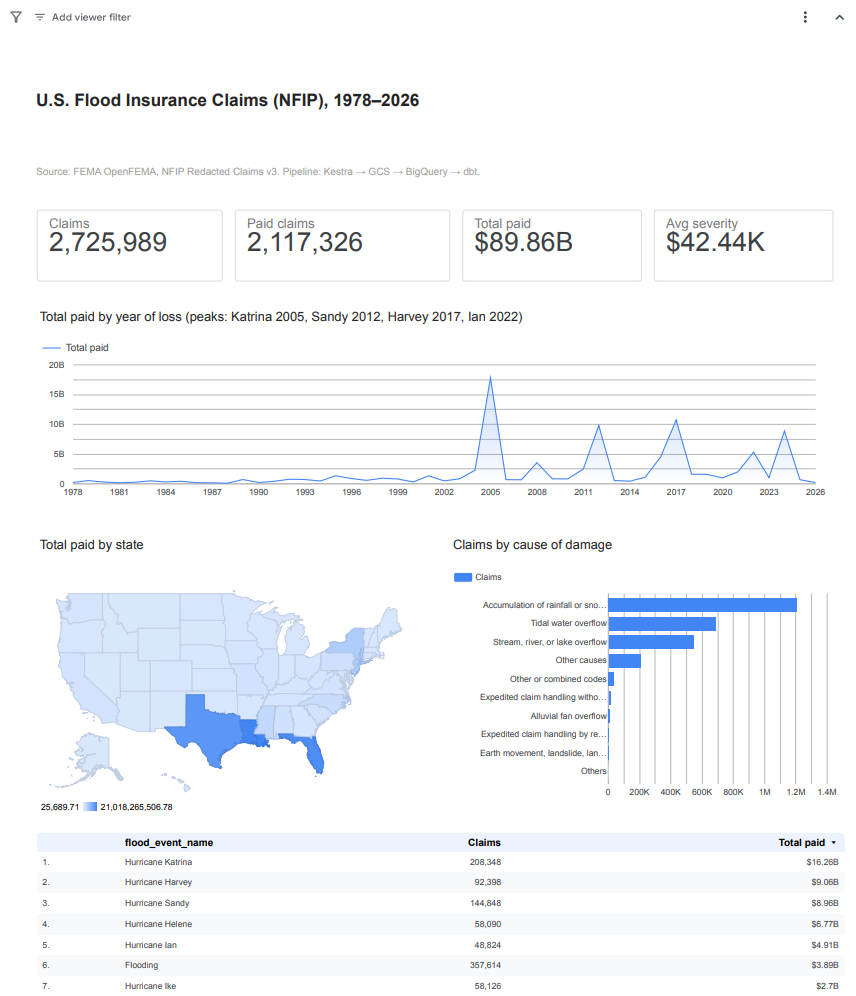
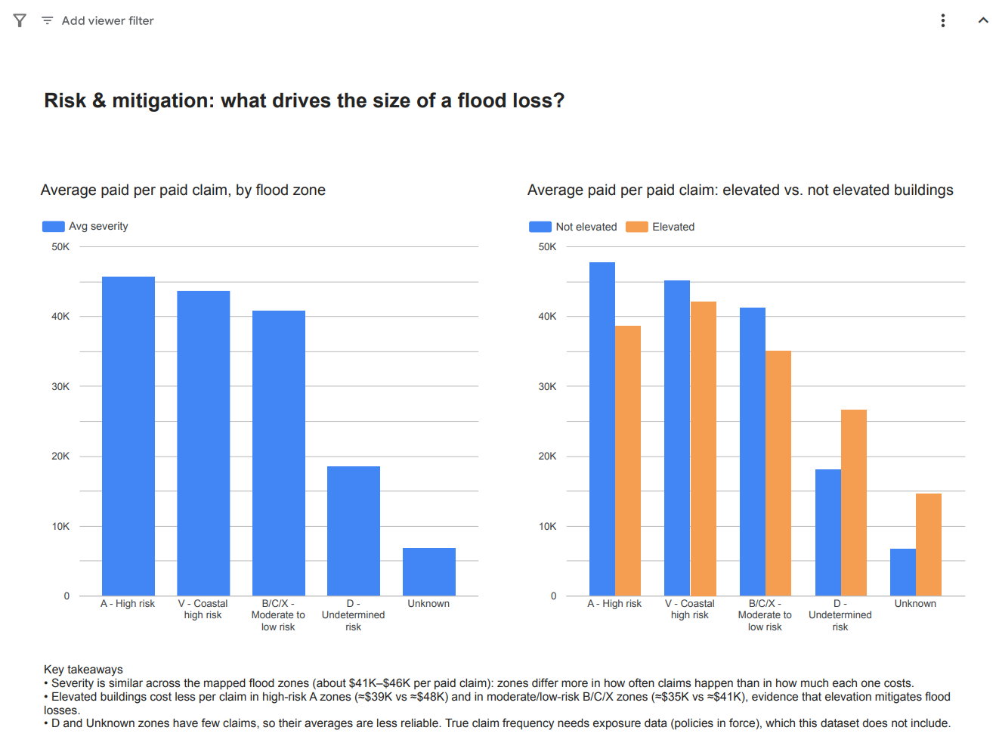
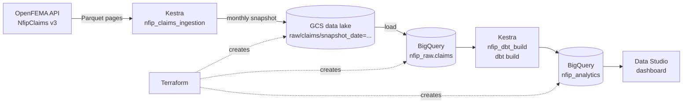

# NFIP Flood Claims Pipeline

End-to-end batch data pipeline for **U.S. flood insurance claims** (FEMA's National Flood Insurance Program, 1978–present): OpenFEMA API → Kestra → Google Cloud Storage → BigQuery → dbt → Data Studio.

Built as the capstone of the [DataTalksClub Data Engineering Zoomcamp](https://github.com/DataTalksClub/data-engineering-zoomcamp) (self-paced), following the course's project criteria.

**[Live dashboard](https://datastudio.google.com/reporting/94ae9b53-be67-4e0b-8b9c-b034c31ad05f)**

| Overview | Risk & mitigation |
|---|---|
|  |  |

---

## Problem

The NFIP insures millions of U.S. properties against flood and has paid about **$90 billion** across **2.7 million claims**. FEMA publishes every claim (anonymized) through OpenFEMA, but in a raw form: 80+ columns with coded values, refreshed roughly monthly, and with no ready-made view for analysis.

This project turns that raw feed into a reliable, monthly refreshed analytics layer that answers questions an insurer, reinsurer or risk analyst would ask:

- How have flood losses evolved over time, and which events drove them (Katrina, Sandy, Harvey, Ian)?
- Which states concentrate the losses?
- What causes flood damage most often?
- Does the flood zone of a property change how much each claim costs?
- Does **elevating a building** reduce the size of a loss?

## Architecture



| Layer | Tool |
|---|---|
| Cloud | Google Cloud Platform |
| Infrastructure as code | Terraform |
| Orchestration | Kestra 2.0 (Docker Compose, Postgres backend) |
| Data lake | Google Cloud Storage |
| Data warehouse | BigQuery |
| Transformations and tests | dbt Core 1.12 + dbt-bigquery |
| Dashboard | Data Studio |

## Dataset

FEMA OpenFEMA, FIMA NFIP Redacted Claims v3 ([API endpoint](https://www.fema.gov/api/open/v3/NfipClaims?$top=1), [OpenFEMA data sets](https://www.fema.gov/about/openfema/data-sets)): one row per flood insurance claim, about 2.7 million rows and 80+ columns (dates, location, flood zone, building characteristics, coverage, damage and payments). Public domain, refreshed by FEMA roughly every 1–2 months.

## How the pipeline works

### 1. Ingestion (Kestra flow `nfip_claims_ingestion`)

Runs on the 5th of every month at 06:00 UTC.

1. **extract**: downloads the full dataset from the OpenFEMA API in Parquet pages of 10,000 rows, merges them with DuckDB and checks the result before anything is written:
   - the row count matches the count reported by the API;
   - there are no duplicate ids.
2. **upload_to_gcs**: stores the snapshot as `gs://<bucket>/raw/claims/snapshot_date=YYYY-MM-DD/claims.parquet`. Every monthly snapshot is kept, so any past state of the data can be reloaded.
3. **load_to_bigquery**: loads the snapshot into `nfip_raw.claims`, replacing the previous one.
4. **run_dbt**: calls the `nfip_dbt_build` flow and fails the run if dbt fails.

The flow has a **test mode** (`start_after_id` and `max_records` inputs) that downloads only a slice of the data and skips the GCS upload, the BigQuery load and dbt. It is useful for checking changes in a couple of minutes instead of an hour.

### 2. Transformations (Kestra flow `nfip_dbt_build`)

Kestra clones this repository and runs `dbt deps && dbt build` in a Python container. The dbt code lives only in Git, so there is a single source of truth and no SQL copied into the orchestrator.

| Model | Type | Description |
|---|---|---|
| `stg_claims` | view | One row per claim: snake_case names, total paid amount, flood zone risk group, SFHA flag. No rows are filtered out. |
| `cause_of_damage_codes` | seed | Lookup of FEMA cause-of-damage codes. |
| `fct_claims` | table | Claims fact table used by the dashboard: business-friendly columns and decoded cause of damage. **Partitioned by month of loss, clustered by state and flood zone group.** |
| `agg_claims_by_state_year` | table | Claims, total paid and severity by state and year. |
| `agg_claims_by_flood_zone` | table | Claims, total paid, severity and average water depth by flood zone group and building elevation. |

**Tests** (15 data tests): unique and not-null keys in the source, the seed and the models, accepted values for the flood zone groups, unique combinations in the aggregates, and a source freshness check (warn after 75 days, error after 120). Negative payments only produce a warning, because FEMA documents them as reissued checks.

### 3. Dashboard

Two pages, with a viewer filter bar (state, date of loss, flood zone group, cause of damage):

- **Overview**: claims, paid claims, total paid and average severity; total paid by year of loss; total paid by state (map); claims by cause of damage; top flood events.
- **Risk & mitigation**: average paid per paid claim by flood zone, and elevated vs. non-elevated buildings by flood zone, with written takeaways.

## Design decisions

**Full monthly snapshot instead of incremental loads.** FEMA keeps updating existing claims (new payments, corrections) and the dataset has no reliable "last modified" column, so an incremental load could silently miss changes. At 2.7 million rows a full reload is cheap, always correct, and the GCS snapshots keep the full history for audit or reprocessing.

**OpenFEMA API instead of the bulk file.** The bulk Parquet file on fema.gov returns HTTP 403 to non-browser clients, and the v2 dataset was retired in October 2026. The v3 API supports `$format=parquet`, which keeps the download compact and typed.

**Keyset pagination instead of `$skip`.** Requesting `id > last_id ORDER BY id` makes every page equally cheap for the server. With `$skip`, deep pages got progressively slower and eventually failed.

**Adaptive page size with a JSON fallback.** A few records make the API abort its Parquet response mid-stream (ids 6598548 and 6819449 at the time of writing). When a page fails, the page size shrinks 10x until the bad record is isolated; that single record is fetched as JSON, cast to the Parquet schema, and the page size grows back. Every page is validated by reading it back, because a cut-off response can still look like a successful download.

**Data quality gates before loading.** Nothing reaches the lake or the warehouse unless the row count matches the API and every id is unique.

**Partitioning and clustering.** The dashboard filters by date of loss, state and flood zone, so `fct_claims` is partitioned by `date_of_loss` and clustered by `state` and `flood_zone_group`. Monthly partitions were chosen over daily ones because the data covers almost 50 years: daily partitions would mean around 18,000 tiny partitions, above BigQuery's per-table limit, while monthly partitions give about 600 of a useful size.

**Secrets stay out of Git.** The service account key is mounted read-only into Kestra and passed to dbt as a Kestra secret. `.env`, keys and Terraform state are git-ignored.

## From stored procedures to dbt

My background is 5+ years of SQL Server development in insurance, where the transformation layer was stored procedures, temp tables and manual checks. This project maps the same work to modern practices:

| SQL Server habit | In this project |
|---|---|
| Stored procedure per transformation | One dbt model per transformation, version-controlled |
| Temp tables and nested subqueries | CTEs (`source → renamed → final`) |
| Execution order maintained by hand | DAG built by dbt from `ref()` and `source()` |
| Manual sanity queries after a load | dbt tests and source freshness, run on every build |
| SQL Agent job | Kestra flow with schedule, retries and logs |
| Indexes | BigQuery partitioning and clustering |

## Insurance glossary

| Term | Meaning |
|---|---|
| **NFIP** | National Flood Insurance Program, run by FEMA. It writes most flood insurance in the U.S. |
| **Claim** | Request for payment after a flood. A claim can be closed without payment. |
| **Paid claim** | Claim with total payment > 0. |
| **Severity** | Average amount paid per paid claim. |
| **Frequency** | Claims relative to the number of insured properties. Needs exposure data, not available here. |
| **Exposure** | Policies in force: the base for frequency and loss ratios. |
| **Flood zone** | FEMA risk classification. **A**: high risk (1% annual chance); **V**: coastal high risk with wave action; **B/C/X**: moderate to low risk; **D**: undetermined. |
| **SFHA** | Special Flood Hazard Area: zones A and V, where flood insurance is mandatory for federally backed mortgages. |
| **Elevated building** | Building raised above the expected flood level (piers, posts, columns). |
| **ICC** | Increased Cost of Compliance: coverage for elevating, relocating or demolishing a damaged building to meet local rules. |
| **Post-FIRM** | Built after the community's first Flood Insurance Rate Map, so it had to follow flood-resistant standards. |

## Data limitations

- **No exposure data.** The dataset only contains claims, not policies in force, so frequency and loss ratios can't be computed. Joining the OpenFEMA NFIP Policies dataset is the natural next step.
- **Nominal dollars.** Amounts are not adjusted for inflation, so a 1980 claim and a 2024 claim aren't directly comparable.
- **Generic event names.** About 358,000 claims have the event name "Flooding" instead of a named event.
- **Negative payments.** 86 claims have a negative total paid. FEMA documents them as reissued checks, so the dbt test only warns about them.
- **Redacted data.** Locations are generalized for privacy, so the analysis stays at state, county or ZIP level.
- **Recent events are still developing.** Claims for the latest events are still being paid, so recent totals will grow.

## Repository structure

```
.
├── terraform/               # GCS bucket and BigQuery datasets
├── docker-compose.yml       # Kestra 2.0 + Postgres
├── kestra/flows/
│   ├── nfip_claims_ingestion.yml   # API → GCS → BigQuery → dbt (monthly)
│   └── nfip_dbt_build.yml          # git clone + dbt build
├── dbt/
│   ├── models/staging/      # stg_claims + source and tests
│   ├── models/marts/        # fct_claims + aggregates + tests
│   ├── seeds/               # cause of damage codes
│   └── profiles.yml         # reads PROJECT_ID, REGION and the key path from the environment
├── docs/                    # dashboard screenshots, raw table schema
├── requirements.txt         # dbt versions used by Kestra and locally
└── .env.example             # every setting needed to reproduce the project
```

## How to reproduce

Tested on Windows with Git Bash and Docker Desktop. The same commands work in bash on Linux and macOS.

> On Windows, run every command in **Git Bash**, not PowerShell or CMD (in VS Code: terminal dropdown → Git Bash). Unless a step says otherwise, run commands from the repository root.

### Prerequisites

- A GCP account with billing enabled. Everything fits in the free tier.
- [gcloud CLI](https://cloud.google.com/sdk/docs/install)
- [Terraform](https://developer.hashicorp.com/terraform/install) >= 1.5
- [Docker Desktop](https://www.docker.com/products/docker-desktop/) (or Docker Engine + Compose)
- Optional: Python 3.12+, only to run dbt outside Kestra

### 1. Clone and configure

Fork the repository first if you want to change the dbt code: Kestra clones the repository set in `GIT_REPO_URL`, which must be public.

```bash
git clone https://github.com/vinithedev/nfip-flood-claims-pipeline.git
cd nfip-flood-claims-pipeline
cp .env.example .env
```

Edit `.env` and set at least `PROJECT_ID` and `GOOGLE_APPLICATION_CREDENTIALS` (on Windows, use forward slashes: `C:/Users/you/.gcp/nfip-pipeline.json`). The key file doesn't exist yet: step 2 creates it at that path. If you already have a key with that name for another project, choose a different file name. Then load `.env` and check it:

```bash
set -a; source .env; set +a
echo "[$PROJECT_ID] [$GOOGLE_APPLICATION_CREDENTIALS]"   # both must be filled in
```

> `set -a` exports every variable defined while sourcing, so Terraform, Docker Compose and dbt can read them. Run this line again in every new terminal: if a command complains about a missing value (for example `gcloud config set project` saying `VALUE: Must be specified`), `.env` isn't loaded.

### 2. Set up GCP

```bash
gcloud auth login
gcloud config set project $PROJECT_ID
gcloud services enable bigquery.googleapis.com storage.googleapis.com

gcloud iam service-accounts create nfip-pipeline --display-name="NFIP pipeline"

gcloud projects add-iam-policy-binding $PROJECT_ID \
  --member="serviceAccount:nfip-pipeline@${PROJECT_ID}.iam.gserviceaccount.com" \
  --role="roles/storage.admin"

gcloud projects add-iam-policy-binding $PROJECT_ID \
  --member="serviceAccount:nfip-pipeline@${PROJECT_ID}.iam.gserviceaccount.com" \
  --role="roles/bigquery.admin"

mkdir -p "$(dirname "$GOOGLE_APPLICATION_CREDENTIALS")"
gcloud iam service-accounts keys create "$GOOGLE_APPLICATION_CREDENTIALS" \
  --iam-account=nfip-pipeline@${PROJECT_ID}.iam.gserviceaccount.com
```

Add the key to `.env` as base64 (Kestra passes it to dbt as a secret), then reload `.env`:

```bash
echo "GCP_SERVICE_ACCOUNT_B64=$(base64 < "$GOOGLE_APPLICATION_CREDENTIALS" | tr -d '\n')" >> .env
set -a; source .env; set +a
```

> The key file and `.env` are git-ignored. Never commit them.

### 3. Create the infrastructure

```bash
cd terraform
terraform init
terraform apply
cd ..
```

This creates the bucket `${PROJECT_ID}-data-lake` and the datasets `nfip_raw` and `nfip_analytics`.

### 4. Start Kestra

Make sure Docker Desktop shows **Engine running**, then:

```bash
docker compose up -d
docker compose ps    # postgres: healthy, kestra: running
```

Open http://localhost:8080 and sign in with `admin@kestra.io` / `Admin1234!`.

> If Docker Desktop fails to start with `ERROR_NO_SYSTEM_RESOURCES`, Windows couldn't reserve memory for its WSL virtual machine. Quit Docker Desktop, run `wsl --shutdown`, close memory-heavy apps and start it again; if that isn't enough, restart Windows and open Docker Desktop first.

### 5. Deploy the flows

```bash
for flow in kestra/flows/*.yml; do
  curl -s -u 'admin@kestra.io:Admin1234!' \
    -X POST http://localhost:8080/api/v1/main/flows/import \
    -F fileUpload=@"$flow"
  echo
done
```

The endpoint returns the flows that failed to import, so `[]` for each file means success. Alternatively, in the Kestra UI: **Flows → Create**, paste the content of each file and save.

### 6. Run the pipeline

In the Kestra UI, open **Flows → nfip → nfip_claims_ingestion → Execute** and keep the default inputs (`page_size` 10000, `start_after_id` empty, `max_records` 0).

The full run takes about an hour: around 55 minutes to download the 2.7 million records from the API, then a few minutes for the load and dbt. When it finishes, `nfip_analytics.fct_claims` is ready. After that, the flow runs by itself every month.

> To check the setup quickly first, run it with `max_records = 20000`. Test mode downloads only those rows and skips the load and dbt.

### 7. (Optional) Run dbt locally

```bash
python -m venv .venv
source .venv/Scripts/activate      # Linux/macOS: source .venv/bin/activate
pip install -r requirements.txt
cd dbt
dbt deps
dbt build
dbt source freshness
```

`dbt/profiles.yml` reads `PROJECT_ID`, `REGION` and `GOOGLE_APPLICATION_CREDENTIALS` from the environment, so `.env` must be loaded.

### 8. Dashboard

The report's metrics and the map field are calculated fields stored in its data source, so copy the report **with its data source** and then point that data source to your project. Replacing the data source in the copy dialog drops those fields and breaks the charts.

1. Open the [live dashboard](https://datastudio.google.com/reporting/94ae9b53-be67-4e0b-8b9c-b034c31ad05f) and choose **⋮ → Make a copy**. Keep the data source as it is and click **Copy report**.
2. In the copy, open **Resource → Manage added data sources** and click **Edit** on `fct_claims`.
3. Select **BigQuery → your project → `nfip_analytics` → `fct_claims`** and click **Reconnect**. If Data Studio asks you to confirm the field changes, click **Apply**, then **Done** and **Close**.

The numbers should match the live dashboard (2,725,989 claims, $89.86B paid). To confirm the copy is reading your project, `bq ls -j -n 10 --project_id=$PROJECT_ID` should list the dashboard's recent queries.

If you build the report from scratch instead, these are the calculated fields it uses:

| Field | Formula |
|---|---|
| Claims | `COUNT(claim_id)` |
| Paid claims | `SUM(CASE WHEN is_paid_claim THEN 1 ELSE 0 END)` |
| Total paid | `SUM(total_amount_paid)` |
| Avg severity | `SUM(total_amount_paid) / SUM(CASE WHEN is_paid_claim THEN 1 ELSE 0 END)` |
| State (geo) | `CONCAT("US-", state)`, type *Geo → Country subdivision (1st level)* |

### Teardown

```bash
docker compose down -v
cd terraform && terraform destroy
```

Then delete the service account key file, and the GCP project if you created one only for this.

## Cost

Everything runs within the GCP free tier: each monthly snapshot is a few hundred MB in GCS, the BigQuery tables take a few GB at most (10 GB of storage is free), and a monthly dbt build plus dashboard queries stay far below the free 1 TiB of queries per month. Setting a budget alert and a daily BigQuery query quota is still recommended.

## Zoomcamp evaluation criteria

| Criterion | Where |
|---|---|
| Problem description | [Problem](#problem) |
| Cloud | GCP, with all resources created by Terraform (`terraform/`) |
| Data ingestion (batch) | Kestra flow with several steps: API → validated Parquet → GCS → BigQuery → dbt, scheduled monthly |
| Data warehouse | BigQuery, `fct_claims` partitioned and clustered ([why](#design-decisions)) |
| Transformations | dbt models, seed and tests, run from Kestra |
| Dashboard | Data Studio, two pages ([link](https://datastudio.google.com/reporting/94ae9b53-be67-4e0b-8b9c-b034c31ad05f)) |
| Reproducibility | [Step-by-step instructions](#how-to-reproduce) driven by a single `.env` file |
